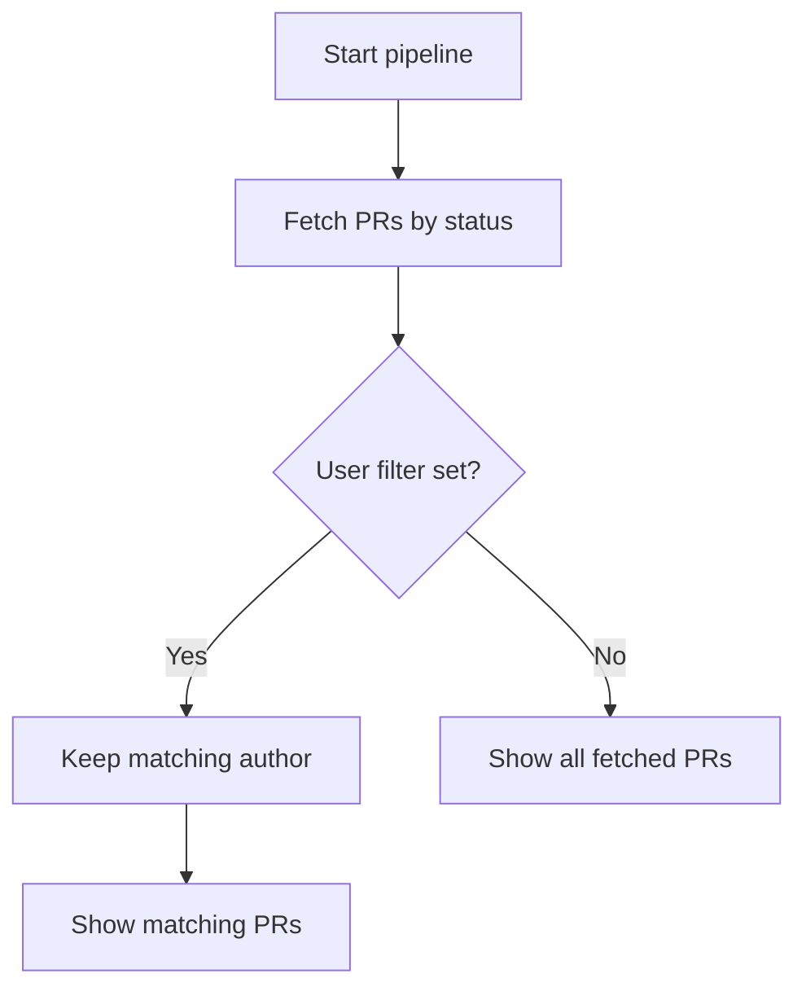
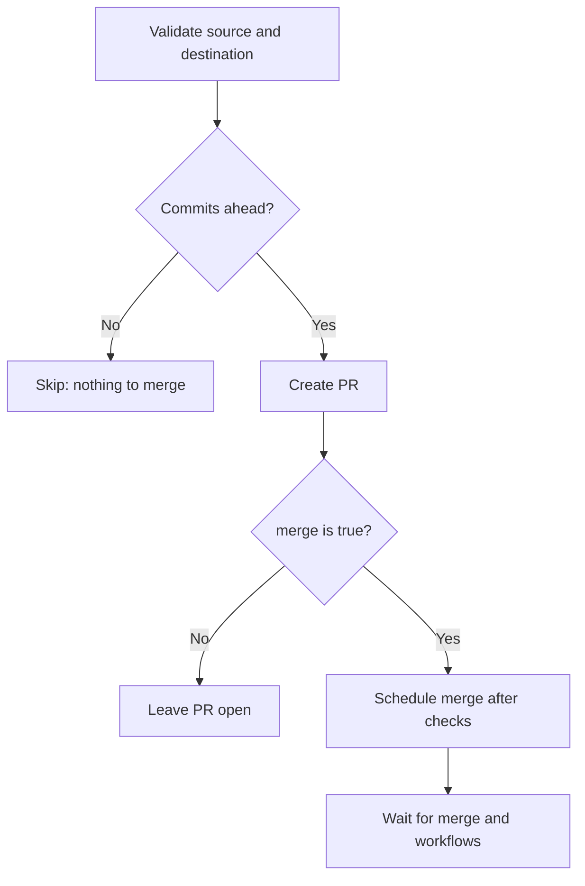
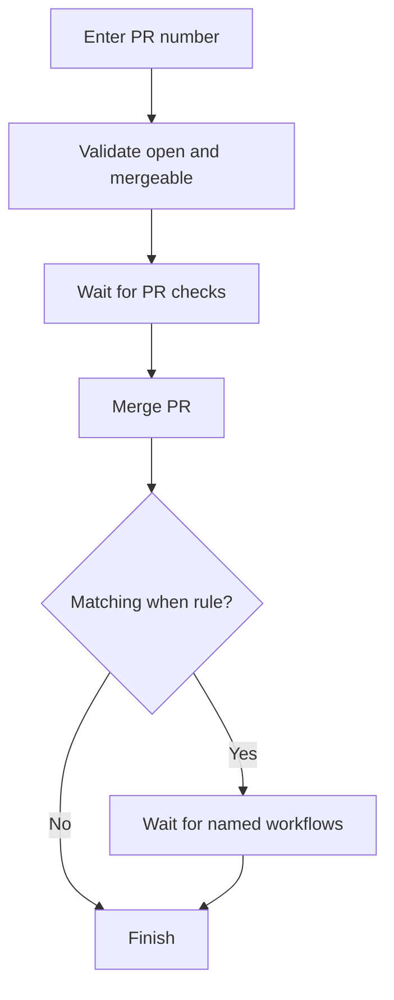
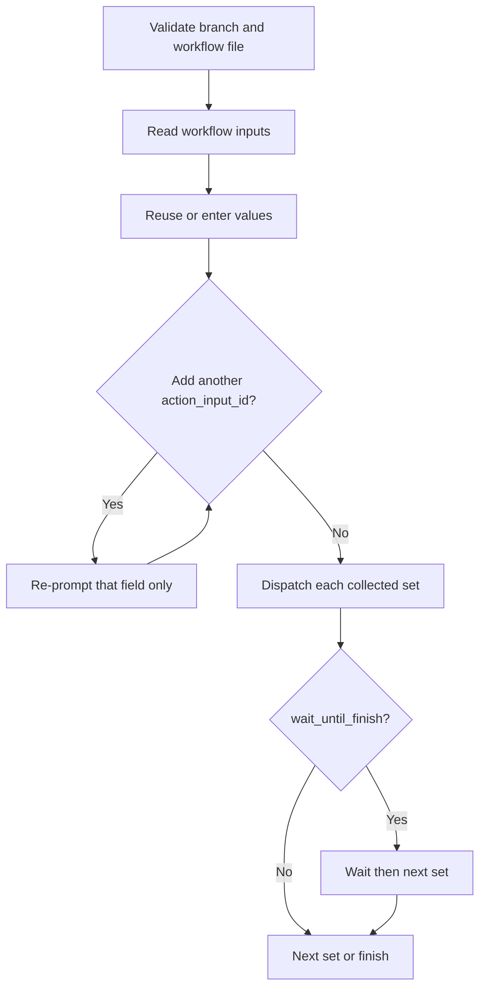
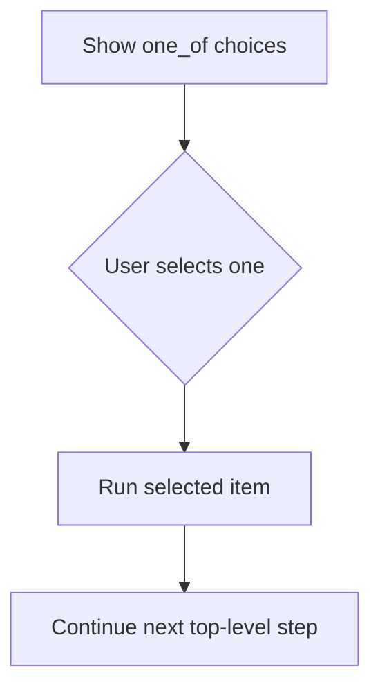

# gitrung

**gitrung** is an interactive release helper for GitHub and Gitea. Describe a repository’s pull-request and workflow actions in YAML, then run them in a guided order.

A release often means doing the same tedious sequence by hand:

1. Create a PR from a feature branch to `develop`, then wait for it to merge.
2. Wait for the Docker image build.
3. Deploy the image to the test environment.
4. Create a PR from `develop` to `main`, then wait for it to merge.
5. Wait for the Docker image build again.
6. Deploy the image to production.

 You need to either do all of that or skip some steps on regular basis. Doing that manually is boring. `gitrung` makes the release flow declarative, repeatable, and guided.

| Tool | What it does |
| --- | --- |
| `list_pr` | Lists pull requests, optionally limited to one author. |
| `create_pr` | Creates a pull request and can merge it after checks pass. |
| `merge_pr` | Merges an existing pull request after its checks pass. |
| `run_workflow` | Dispatches a repository workflow on a selected branch. |
| `one_of` | Lets the user pick exactly one of several leaf steps. |

Every step uses a `type` plus an `options` object. Choice groups use `type: one_of` with `items`.

## Full example

```yaml
url: https://github.com/acme/storefront
git_platform: github
steps:
  - type: create_pr
    options:
      source_branch: feature/catalog
      destination_branch: develop
      merge: true
      after_merge:
        wait_for:
          - docker-develop.yaml

  - type: run_workflow
    options:
      workflow: deploy-test.yaml
      use_workflow_from_branch: develop

  - type: create_pr
    options:
      source_branch: develop
      destination_branch: main
      merge: true
      after_merge:
        wait_for:
          - docker-main.yaml

  - type: run_workflow
    options:
      workflow: deploy-production.yaml
      use_workflow_from_branch: main
```

## Start here

1. Download the `.zip` for your platform from the [releases page](https://github.com/md-redwan-hossain/gitrung/releases) (for example `gitrung-windows-x64.zip` or `gitrung-linux-x64.zip`) and extract the binary.
2. Create a folder and place the extracted binary inside it. Create `configs` and `.env` alongside the binary:

```text
gitrung/
├── gitrung                 # macOS/Linux binary (from the zip)
├── gitrung.exe             # Windows binary (from the zip)
├── .env
└── configs/
    └── storefront.yaml
```

3. Create `configs/storefront.yaml` (or any `<name>.yaml`) with your repo URL, platform, and steps.
4. Add the matching token to `.env`:

```sh
# GitHub: repository and workflow access
GITHUB_TOKEN=your_token

# Gitea
GITEA_TOKEN=your_token
```

5. Open a terminal in `gitrung`, then check and run it:

```sh
./gitrung doctor
./gitrung --repo storefront
```

> On Windows, use `.\gitrung.exe` instead of `./gitrung`.

### Run from anywhere

Rename the macOS/Linux binary to `gitrung` (keep the `.exe` extension on Windows), then add the `gitrung` folder to your system `PATH`. You can now run:

```sh
gitrung doctor
gitrung --repo storefront
```

When running outside the `gitrung` folder, either keep a `configs` folder and `.env` in your current directory or explicitly choose the config directory:

```sh
gitrung doctor --config /path/to/gitrung/configs
gitrung --repo storefront --config /path/to/gitrung/configs
```

> A config’s **label is its filename**. `configs/storefront.yaml` is selected with `--repo storefront`; do not add a `label` property.

## Commands

| Command | Why use it | Example |
| --- | --- | --- |
| `gitrung` | Run a repository’s configured release flow. Prompts for a repo when there is more than one. | `gitrung --repo storefront` |
| `gitrung doctor` | Same health checks as a normal run: IO access (configs/`.env` read, metadata/upgrade write) plus parse and validate every config. | `gitrung doctor --config ./configs` |
| `gitrung upgrade` | Check for and install the latest compiled executable. | `gitrung upgrade` |

## Repository properties

| Property | Required | Meaning | Example |
| --- | --- | --- | --- |
| `url` | Yes | Repository URL. | `https://git.example.test/acme/storefront` |
| `git_platform` | Yes | API provider: `github` or `gitea`. | `gitea` |
| `steps` | Yes | Ordered actions to run; at least one is required. | An array of step objects. |

## Step tools

Each leaf step looks like:

```yaml
type: <tool-name>
options:
  # tool-specific fields
```

### `list_pr`

Use it to review pull requests. It runs in step order like every other tool (often placed first).

```yaml
type: list_pr
options:
  status: open
  user: alex
  confirm_before_run: true
```



| Property | Required | Meaning |
| --- | --- | --- |
| `type` | Yes | Must be `list_pr`. |
| `options.status` | Yes | PR state: `open`, `closed`, or `all`. |
| `options.user` | No | Show only PRs authored by this login. |
| `options.confirm_before_run` | No | Default `false`. If `true`, prepare asks Yes/Skip before the step runs. |

### `create_pr`

Use it to create a PR. With `merge: true`, gitrung schedules the merge after checks pass, waits for it, then can wait for named workflows on the destination branch.

```yaml
type: create_pr
options:
  source_branch: staging
  destination_branch: production
  title: Promote staging to production
  body: Release storefront changes to production.
  merge: true
  after_merge:
    wait_for:
      - build-production.yaml
```



| Property | Required | Meaning |
| --- | --- | --- |
| `type` | Yes | Must be `create_pr`. |
| `options.source_branch` | No | Branch to promote. When omitted, gitrung asks for it. |
| `options.destination_branch` | Yes | Branch that receives the PR. |
| `options.title` | No | PR title. A descriptive default is generated when omitted. |
| `options.body` | No | PR body. A default is generated when omitted. |
| `options.merge` | Yes | `true` schedules merge after checks; `false` leaves the new PR open. |
| `options.after_merge` | When `merge` is `true` | Post-merge wait settings; not allowed when `merge` is `false`. |
| `options.after_merge.wait_for` | Yes with `after_merge` | Workflow filenames to wait for successfully on the destination branch. An empty list is allowed. |

### `merge_pr`

Use it when someone already opened the PR. gitrung asks for the PR number, verifies it is open and mergeable, waits for checks, merges it, and optionally waits for follow-up workflows.

```yaml
type: merge_pr
options:
  when:
    - destination_branch: staging
      wait_for:
        - build-staging.yaml
```



| Property | Required | Meaning |
| --- | --- | --- |
| `type` | Yes | Must be `merge_pr`. |
| `options.when` | No | Rules for post-merge workflow waits. Defaults to `[]`. |
| `options.when[].destination_branch` | Yes per rule | Apply this rule when the PR targets this branch. |
| `options.when[].wait_for` | Yes per rule | One or more workflow filenames that must succeed after the merge. |

### `run_workflow`

Use it to manually dispatch a workflow file on a branch. If its `workflow_dispatch` definition has inputs, gitrung prompts for them and remembers the most recent values per repository and workflow.

With `when` + `repeat: true`, gitrung collects every input set first (prompt once, then ask whether to add another value for `action_input_id`), then dispatches each set. The full batch is saved to history and can be reused together on the next run. Waiting (`wait_until_finish`) runs only in that dispatch phase—never between “add another?” prompts.

```yaml
type: run_workflow
options:
  workflow: production-deploy.yaml
  use_workflow_from_branch: main
  when:
    - action_input_id: client
      repeat: true
```



| Property | Required | Meaning |
| --- | --- | --- |
| `type` | Yes | Must be `run_workflow`. |
| `options.workflow` | Yes | Workflow filename in the platform workflow directory. |
| `options.use_workflow_from_branch` | Yes | Branch to use the workflow from (and dispatch on), matching the host UI picker. |
| `options.wait_until_finish` | No | Wait for each dispatched workflow to succeed. Defaults to `true`. |
| `options.exit_on_error` | No | Stop the pipeline when dispatch or waiting fails. Defaults to `true`. |
| `options.when[].action_input_id` | With `repeat` | `workflow_dispatch` input id to vary across runs (for example `client`). |
| `options.when[].repeat` | No | When `true`, collect multiple values for that input first, then dispatch once per set. |

### `one_of`

A `one_of` step is not an action itself. It presents its `items` and runs exactly one choice. Use it to offer “create a PR” **or** “merge an existing PR” without executing both.

```yaml
type: one_of
items:
  - type: create_pr
    options:
      source_branch: feature/catalog
      destination_branch: staging
      title: Promote catalog changes to staging
      body: Prepare the catalog release for staging.
      merge: false
  - type: merge_pr
    options:
      when:
        - destination_branch: staging
          wait_for:
            - build-staging.yaml
```



| Property | Required | Meaning |
| --- | --- | --- |
| `type` | Yes | Must be `one_of`. |
| `items` | Yes | Two or more non-group (`type` + `options`) steps. Nested `one_of` is not supported. |

## Practical rules

- Config files must be `.yaml` or `.yml`.
- Steps always **prepare** first (confirm / collect inputs / choose one_of), then **execute** in config order. There is no mid-pipeline confirm for steps that already ran.
- Workflow filenames are validated remotely before gitrung uses them.
- `metadata.jsonc` keeps the history from previous runs, including the last used workflow inputs (and full repeat batches), plus source branches.
- A normal run and `doctor` share the same health checks (IO permissions plus config validation); run `doctor` after editing a config to catch problems early.
